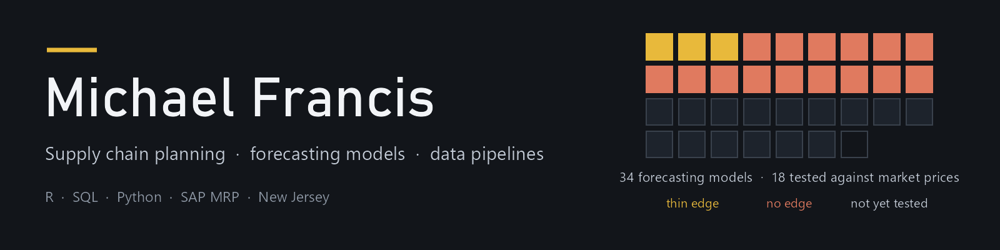
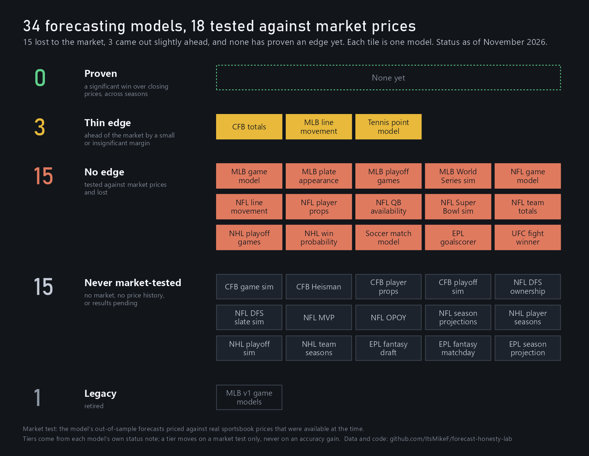

### Supply chain planner who builds forecasting models

I work in supply chain: SAP MRP planning, inventory parameters, carriers and raw-material
procurement. On my own time I build forecasting systems in R. Wherever a market exists, I grade
them against its prices, the toughest benchmark there is, and I publish the ones that lose.

<table>
  <tr>
    <td align="center" width="25%"><h3>958</h3>commits since 2022</td>
    <td align="center" width="25%"><h3>1,374</h3>R scripts</td>
    <td align="center" width="25%"><h3>34</h3>forecasting models</td>
    <td align="center" width="25%"><h3>18</h3>tested against market prices</td>
  </tr>
</table>

## Featured: the forecast honesty lab

[**forecast-honesty-lab**](https://github.com/ItsMikeF/forecast-honesty-lab) is the scorecard for
every forecasting model I've documented. **15 of the 18 tested against real market prices lost**,
and the losers taught me the most. The repo has eight lessons on testing a forecast honestly, each
with the number that taught it.

## How I work

- **A model isn't done until it beats a benchmark it didn't pick.** Beating last year's average
  is easy. Beating the market price is the test.
- **Backtests are as-of: the data *and* the model.** A model trained on the season it's graded
  on is measuring memory ([lesson 1](https://github.com/ItsMikeF/forecast-honesty-lab#1-the-model-has-to-be-as-of-not-just-the-data)).
- **Every new feature races a column of random noise.** If noise improves the metric too, the
  gain isn't real ([lesson 3](https://github.com/ItsMikeF/forecast-honesty-lab#3-every-new-feature-has-to-beat-random-noise)).
- **The losers get published too.** A tier moves on a market test only, never on an accuracy
  gain.

## Also in the private repo

Most of my work runs on licensed data, so the code stays private. Highlights:

- **A baseball plate-appearance model.** It's XGBoost on Statcast pitch data, trained on the GPU
  through an R-to-Python handoff (172 seconds, against 5–10 minutes on the CPU).
- **Price archives for seven sports**, so every model is tested at prices that really existed.
- **An enrollment web app for a local daycare's summer camp.** It's built on Next.js and PostgreSQL
  with row-level security. Its seat booking can't oversell: six simultaneous requests for the last
  seat produced one booking and five waitlist spots.
- **Data audits that change answers.** A public college-football data release had sorted its
  plays as text, which broke its expected-points numbers (team EPA correlated with points at 0.45
  instead of about 0.77). I caught it and repaired it in-house.
- **25 years of hourly rainfall for my town.** Storms are ranked by peak intensity and by total
  rain, and the next forecast storm is placed in that record.

## Tools

I build with [Claude Code](https://claude.com/claude-code) as an AI pair programmer. I direct the
questions and make the calls; the code, the tests and the write-ups are a collaboration.
